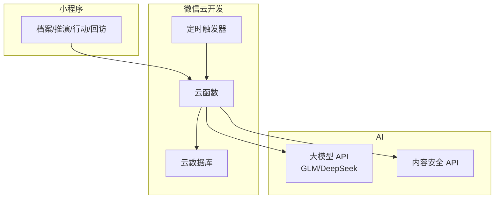

# 人生导演台 · 微信小程序设计文档

> 版本：v1.0 ｜ 日期：2026-10-12 ｜ 状态：参赛设计稿（2026 微信小程序开发大赛，截止 10-17）
> 定位：**AI 模拟你的人生，推演你的未来，给你可执行的当下规划。**

---

## 一、产品定义

### 1.1 一句话定位

**"在 AI 里活一遍你的人生，再回来过好当下。"**
用户输入自己的现状（年龄/城市/职业/存款/目标），AI 构建"平行人生模拟器"：推演 1/3/5/10 年后的多种人生分支，给出建议路径与当下行动清单。

### 1.2 与常见 AI 助手的差异

| 常见 AI 助手 | 人生导演台 |
|------------|-----------|
| 问答制，问一次答一次 | 建立个人人生档案，持续推演、可回溯对比 |
| 给通用建议 | 用你自己的参数模拟，分支可视化 |
| 无后续 | 规划落成行动清单 + 通知提醒 + 定期回访（"上个月说要考证，进度如何？"） |

### 1.3 核心功能

| 编号 | 功能 | 优先级 | 说明 |
|------|------|--------|------|
| F01 | 人生档案 | P0 | 8 组全量信息（基本/学历/职业/财务/健康/家庭/社交/目标），全字段支持备注，渐进式采集+完整度激励 |
| F02 | 人生推演 | P0 | 生成 1/3/5/10 年多分支未来（保守/进取/冒险三种策略） |
| F03 | AI 导师意见 | P0 | 对任一分支追问：这条路最大的风险？我该怎么准备？ |
| F04 | 行动清单 | P0 | 把目标路径拆成本周/本月可执行动作 |
| F05 | 通知回访 | P0 | 订阅消息定期回访进度、行动到期提醒（用户明确要求支持通知） |
| F06 | 人生日记 | P1 | 阶段性记录真实进展，AI 对照"模拟人生 vs 现实"偏差 |
| F07 | 平行人生对比 | P2 | 同一起点不同选择的沙盘对比 |

### 1.4 法律与内容红线（用户明确要求：不能违法）

| 红线 | 实现 |
|------|------|
| 不构成投资建议 | 输出前缀"以下为模拟推演，非投资建议"；不给出具体股票/基金/币种代码推荐；涉及财务话题输出原则性内容 |
| 不提供医疗/法律诊断 | 健康话题→建议就医；法律话题→建议咨询执业律师；AI 不出具任何"结论性意见" |
| 不模拟违法路径 | 模型 prompt 系统级约束：任何分支不得包含违法、违规、灰色地带行为（如投机钻营、偷逃税、赌博等）；用户问"怎么快速搞钱"时引导到技能成长/合规副业 |
| 不生成有害内容 | 微信内容安全 API（msgSecCheck）全量过滤输入与输出 |
| 隐私 | 人生档案属敏感个人信息：单独同意+可删除+不出售不共享；档案仅用于本人会话上下文 |
| 拟真边界 | 明示"AI 模拟仅供参考，人生无法被预测"，避免用户过度依赖 |

### 1.5 人生档案：全量个人信息采集（从人生开始）

**设计原则：档案是推演的地基，越完整推演越准。采集按"从人生起点到现在"的时间顺序走一遍，像填一份人生简历；所有字段支持备注（自由文本补充说明），备注会进入 AI 推演上下文。**

**采集模块（8 组）：**

| 模块 | 字段 | 录入方式 |
|------|------|---------|
| ① 基本信息 | 姓名/昵称、性别、出生年月、国籍、民族、家乡（省市）、现居城市、婚姻状况、子女情况 | 选择+输入 |
| ② 学历教育 | 最高学历、毕业院校、专业、毕业年份、在校表现（GPA/奖项/学生工作）、证书（语言/职业资格）、进修计划 | 选择+输入 |
| ③ 职业经历 | 当前职业/职级、行业、工作年限、历任职位（公司+岗位+起止年）、职业技能、执业资质、工作强度（965/996） | 列表逐段添加 |
| ④ 财务状况 | 年收入区间、存款/投资区间、房产/车产（有无+贷款状态）、每月固定支出、负债（房贷/车贷/消费贷）、保险配置 | 区间选择（不采集精确金额，降低隐私顾虑） |
| ⑤ 健康状况 | 身高体重、慢性病/既往病史（选填）、运动频率、睡眠质量、烟酒习惯、体检习惯 | 选择+备注 |
| ⑥ 家庭关系 | 父母状况（年龄/健康/是否同住）、伴侣情况、与家人关系满意度、家庭责任（赡养/抚养）、家人期望 | 选择+备注 |
| ⑦ 社交与兴趣 | 好友圈层、社交活跃度、兴趣爱好、特长、社群参与 | 多选+备注 |
| ⑧ 目标与困扰 | 3 个最想实现的目标、当前最大困扰、最担心的未来（养老/职业/财务/健康）、人生信条、羡慕的榜样人生 | 自由输入+语音 |

**备注能力（贯穿所有模块）：**

```
- 每个字段旁有"备注"入口（便签图标），支持文字+语音转写
- 备注示例（学历）: "二本但专业课全年级前5" / （财务）: "存款虽少但家里可支援20万" /
  （健康）: "膝盖旧伤不能跑步" / （家庭）: "父母催婚压力大"
- 备注作为高权重上下文进入 AI 推演——AI 会主动引用备注内容（"你提到膝盖旧伤，推演健身计划时排除了跑步类行动"），
  让用户感到"AI 真的看懂了我"
- 备注可随时增删改；敏感备注（病史等）有单独隐私开关，可不纳入推演上下文
```

**渐进式采集（已被 1.6 修正：无时间压力 + 简洁模式，见 1.6）：**

```
第一次使用: 只必填 ①基本 ③职业 ⑧目标 三组（5分钟），即可首次推演
其余模块: 引导页提示"资料越全，推演越准"，用户可"稍后补充"，推演页显示档案完整度（如 45%）
完整度激励: 补完一个模块 → 重新推演按钮高亮"档案更新了，重新看看你的未来"
隐私控制: 每个模块独立开关"纳入推演"；一键清空档案；数据不出本人会话
```

**数据模型（lifeProfile 集合，JSON 结构示例）：**

```json
{
  "userId": "u_001",
  "basic": { "nickname": "小王", "gender": "m", "birthYm": "1995-06", "nationality": "中国",
              "ethnicity": "汉", "hometown": "浙江/温州", "city": "杭州", "marital": "unmarried" },
  "education": [{ "level": "本科", "school": "XX大学", "major": "计算机", "gradYear": 2017,
                   "honors": "校奖学金", "certs": ["CET-6"], "note": "二本但专业前5" }],
  "career": [{ "company": "A公司", "title": "前端工程师", "from": "2017-07", "to": "2021-03",
               "note": "加班严重" }, { "company": "B公司", "title": "高级前端", "from": "2021-03", "to": null }],
  "finance": { "incomeBand": "20-30w", "savingsBand": "10-30w", "house": "有房贷",
               "debt": "房贷月供6k", "insurance": "医保+意外险", "note": "家里可支援20万" },
  "health": { "chronic": [], "exercise": "每周1次", "sleep": "偏晚睡", "note": "膝盖旧伤不能跑步" },
  "family": { "parents": "同省不同住", "maritalNote": "父母催婚压力大", "satisfaction": 3 },
  "goals": { "want": ["3年内跳槽大厂或出海远程", "30岁前攒够50w"], "worry": "35岁危机",
             "belief": "身体第一", "model": "自由职业者朋友" },
  "completeness": 0.45, "updatedAt": "2026-10-12T22:00:00+08:00"
}
```

**AI 推演上下文注入顺序**：基本→目标→职业→财务→健康→家庭→教育→社交（目标优先级最高，备注跟随所属模块注入），并附指令："引用用户备注原话时用『』标注，让用户感知被理解；档案完整度低于 60% 时，推演结尾主动追问缺失最影响精度的 1-2 个信息。"

### 1.6 采集策略修正：信息优先，无时间压力，支持简洁模式

**产品逻辑再明确：这是"信息驱动"的产品——先把个人信息收集完整、收集准，AI 再根据用户的个人方向（目标/困扰/榜样）做推演。信息是地基，方向是方向盘，两者都要先拿到手，才谈推演。**

**修正点（覆盖 1.5 的节奏设计）：**

| 原设计 | 修正后 |
|--------|--------|
| "5 分钟必填三组即可推演"（有时间压力暗示） | **不设时限、不催促**。采集阶段没有"跳过"倒计时，没有"稍后补充"的压力话术；用户愿意一次填 40 分钟也欢迎 |
| 渐进式+完整度激励 | 保留完整度显示，但定位是"导航"不是"KPI"——告诉用户还差什么能让推演更准，不制造焦虑 |
| 首次即可推演 | **采集未达基础线（①③⑧三组）时推演按钮置灰**，附一句"再给我 3 组信息，推演会准很多"——宁缺毋滥，逼不出好推演 |

**简洁模式（重要）：每个字段都有"写不动就一句话"的出路。**

```
双轨录入，随时切换:
  详细模式: 逐字段表单（如 1.5 的 8 组结构）
  简洁模式: 每组就是一两个大输入框 + 示例引导，用户用自己的话随便写:

    [基本信息] "我叫小王，95年，温州人，在杭州做程序员，未婚"
    [学历职业] "二本计算机毕业，做过两家公司，现在高级前端，加班多"
    [财务健康] "年入25w存款20w有房贷，身体还行就是膝盖不好，爱熬夜"
    [目标方向] "想三年内去大厂或出海远程，怕35岁危机，最羡慕自由职业的朋友"

  → AI 解析: 自动拆解成结构化字段（解析结果回显让用户确认/修正）
  → 解析不出的字段留空+追问一次（"存款大概哪个区间？"），不逼答
  → 用户混用: 大部分字段简洁写，个别字段（如病史）再点开详细表单细填
```

**AI 解析管线（简洁模式的核心）：**

```
输入自由文本 → 大模型结构化提取(JSON) → 字段映射回显 → 用户确认/修正 → 入库
安全: 解析前过内容安全API; 身份证号/手机号等强敏感信息识别到即拒绝并提示"无需提供，也请勿填写"
兜底: 解析置信度低的字段标"待确认"，推演时该字段按模糊处理并在结论中注明假设
```

**个人方向的特殊性（推演的"方向盘"）：**

```
第⑧组"目标与困扰"不是普通信息，是方向输入，单独强化:
  - 目标: 支持模糊目标（"想赚更多钱"）→ AI 追问具体化（"更偏向升职加薪、副业变现，还是换赛道？"）
  - 榜样人生: 用户描述羡慕谁 → AI 提取该路径关键节点，作为推演分支素材
  - 红线值: 用户可声明"不想做的事"（"不想考公""不想加班到10点后""不离开杭州"）
           → 推演硬排除这些分支，如同法律红线一样生效
```

**修订后的启动流程：**

```
选模式: [简洁模式·几句话搞定] / [详细模式·逐项填写] / [语音聊天式·AI问我答]
  ↓
采集（不限时，随时暂停，进度自动保存）
  ↓
AI 解析+回显确认 → 基础线达成 → 推演解锁
```

### 1.7 推演哲学修正：AI 不定长远目标，目标只能用户自己设，按实际推进

**核心原则：AI 不替用户决定人生方向。长远目标只能用户自己设定；AI 只做三件事——让目标具体化、推演到达路径、按实际情况校准节奏。**

| 职责 | 谁负责 |
|------|--------|
| 设定长远目标（想成为什么/想去哪里） | **用户本人，AI 不得代设** |
| 把模糊想法澄清成清晰目标 | AI 追问+用户确认 |
| 推演"到达目标"的可能路径与风险 | AI |
| 把路径拆成近期小步骤 | AI 建议，用户取舍 |
| 根据实际进展调整节奏 | 用户实际数据 + AI 校准 |

**目标层级设计（AI 只向下拆解，不向上设定）：**

```
用户自设的长期目标（如"3年内进大厂"）—— 只能来自用户
   ↓ AI 拆解
阶段目标（半年/季度）—— AI 建议草案，用户修改后生效
   ↓ AI 拆解
本周行动 —— AI 建议草案，用户勾选采纳
   ↓ 用户执行
实际进展 —— 打卡/日记记录真实情况（可能超前/滞后/放弃）
   ↓ 反馈
AI 按实际校准: 滞后→"把本周目标降到2个"; 超前→"可以提前进入下一步";
放弃→不指责，重新和用户确认目标是否要调整（目标本身也可以被用户改掉）
```

**关键约束：**

```
1. AI 生成推演时，若用户未设长期目标 → 分支展示"可能性"而非"目标",
   并明确提示: "这些只是模拟，要不要往哪走，由你决定。想好了告诉我，我帮你拆路线。"
2. 用户设定目标后，AI 不评判目标是否"合理"——只评估可行性要素（时间/资源/现状差距），
   风险说清楚，决定权留给用户。
3. 长远推演(10年)仅作参考视野，不产生任何"承诺性行动"；行动清单只从近期（本周/本月）派生。
4. 目标随时可改: 用户可以修改/放弃目标，AI 记录"目标变更史"，不按旧目标继续催促。
5. 回访通知只围绕"用户自己设的目标"，永远不说"你本应该..."，只说"你给自己定的..."。
```

**话术对照（设计红线）：**

| 场景 | ❌ 禁用 | ✅ 使用 |
|------|--------|--------|
| 未设目标时 | "建议你把目标定为..." | "有一种可能是...，你自己想往哪走？" |
| 目标激进时 | "这个目标不现实，改成..." | "这个目标需要这些条件...当前差距在这，你看是调整节奏还是保持？" |
| 进度滞后时 | "你又没完成，这样不行" | "本周完成了 1/3，是遇到什么事了吗？要不要把步子调小一点？" |
| 用户改目标时 | "怎么又改主意了" | "收到，方向变了很正常。新方向我们重新看看路线。" |

**通知回访同步修正**：回访内容的主体是"用户自设目标+实际进展"，AI 只做校准员，不做监工；每周回访先问感受再谈进度。

### 1.8 目标执行必须符合实际：现实约束引擎 + 阶段校准

**补强点：目标不是口号。用户要实现目标时，系统必须把目标拉回现实——校验现实条件、拆解符合实际、执行中持续对账。**

**① 目标可行性对账（用户设目标时立刻做）：**

```
AI 拿目标对照人生档案，输出"现实检查卡"（不评判，只摆事实）:
  [目标] 3年内进大厂
  [现实条件] 二本+4年经验+无算法背景 + 每周可投入<10h + 距离35岁还有5年
  [通常需要的] 大厂该岗位画像: 985/211或同等级经验+算法+系统设计+英语
  [差距清单] 算法基础0→需300h / 系统设计未系统学→需150h / 简历背书不足
  [节奏判断] 每周10h × 156周 = 1560h ≈ 可覆盖差距(约450h)+缓冲，可行但无余量
  [风险点] 加班强度大可能挤占学习时间(档案备注: 996)
  → 用户看完自己决定: 保持 / 调整为5年 / 换赛道。AI 不替用户改。
```

**② 拆解必须落在真实生活结构上（不是理想课表）：**

```
阶段/周计划生成时强制注入档案现实因素:
  - 可用时间: 工作强度996 → 工作日最多30min, 周末各2h（而不是"每天3小时"）
  - 健康约束: 膝盖旧伤 → 行动排除跑步类
  - 财务约束: 有房贷 → "辞职脱产学习"类分支需标注现金流风险
  - 家庭责任: 父母催婚/同住 → 周末部分时段预留
  - 已有基础: 4年前端经验 → 不从零学,从系统设计切入
  每条行动标注[依据]: "工作日30min片段学习(依据: 你备注过996)" —— 让用户看到计划贴着现实长出来
```

**③ 执行中持续对账（现实变化，计划跟着变）：**

```
实际进展记录来源:
  - 行动打卡(完成/部分/没做+一句原因)
  - 人生日记(语音随手记: "这周加班到11点,啥也没学")
  - 档案更新(收入/岗位/健康变化 → 触发重算)

校准机制:
  连续2周完成率<50% → 不加码,先降载: "拆细一点,本周只做1个小步骤"
  连续2周完成率>90% → 提议升档: "节奏不错,可以加一步"
  现实突变(加班剧增/生病/家事) → 触发"计划冻结"选项: 暂停目标周期,不产生催促通知
  目标截止期临近且差距大 → 提前1/3时间点预警"按当前进度会差XX,要调整目标还是加投入?"
```

**④ 符合实际的话术纪律（写进 prompt）：**

```
- 行动粒度: 每条行动必须"当下就能开始"且附时间成本估算("今晚20:30-21:00")
- 不生成"理想主义课表"(每天5点起床/每天3小时)——除非用户明确表示当前生活允许
- 承认现实阻力: 行动被现实打断时, AI 的第一反应是"重新安排"而不是"强调坚持"
- 拒绝画饼: 不得输出"坚持就能成功"类空话; 只输出条件-路径-概率的语言
```

**数据模型增补**：actions 集合加字段 `actualStatus`(done/partial/missed)、`missReason`、`timeCostActual`；新增 `realityCheck`（现实检查卡快照）、`calibrationLog`（校准记录：触发原因/调整内容）。

### 1.9 回访节奏：每日回访 + 中间回访（用户可随时发起）

**节奏修正：从"每周回访"升级为"每日回访 + 中间回访"。**

| 类型 | 触发 | 内容 | 通知方式 |
|------|------|------|---------|
| 每日回访 | 每天固定时段（用户自选，默认 21:00） | 今日小结：今日行动完成情况+一句校准（"今天没做也没关系，明天从第 2 步继续"）+ 明日 1 件事 | 订阅消息 |
| 中间回访（用户主动） | 用户随时点"和 AI 聊聊" | 任意话题：进展卡住了/心情不好/想改目标/就想聊聊天 | 小程序内对话（不打扰式，不推送） |
| 事件回访 | 系统+AI 判断触发 | 连续 2 天未打卡 / 现实突变（日记提到加班/生病）/ 目标节点 | 订阅消息（温和版） |
| 周对账 | 每周日 | 本周整体完成率+现实检查卡刷新建议 | 订阅消息 |

**每日回访设计原则：**

```
- 轻: 30 秒能完成——3 个快答按钮(做完了/部分做了/今天没顾上) + 可选一句话补充
- 不审判: "没做"不触发说教话术，触发"降载或调整"逻辑（见 1.8 ③）
- 有记忆: 回访开场引用昨天/上周的具体内容（"昨天你说要准备简历，写了吗？"）
- 可暂停: 用户可暂停每日回访（出差/休假），或临时改时间（"这周改到 22 点"）
- 订阅额度: 每日回访消耗订阅消息额度，需引导"总是保持以上选择"；额度不足时自动降级为仅周对账
```

### 1.10 记忆系统（AI 的长期记忆）

**问题：大模型无状态，跨会话就失忆。本产品的核心体验恰恰依赖长期记忆——用户上周说过的话、三个月前的目标、每次回访的细节，AI 都要记得。**

**三层记忆架构：**

| 层 | 内容 | 存储 | 用法 |
|----|------|------|------|
| L1 档案记忆 | 人生档案结构化数据（1.5 的 8 组+备注） | lifeProfile 集合 | 每次推演/对话全量注入（上下文起点） |
| L2 目标与行动记忆 | 用户自设目标、变更史、阶段计划、行动完成情况、现实检查卡 | goals / actions / calibrationLog 集合 | 对话时注入当前目标+最近 2 周行动摘要 |
| L3 对话与事件记忆 | 每次回访/中间回访的对话、用户随口说的话、情绪、重要生活事件 | memoryNotes 集合（AI 提取的记忆条目） | 按相关性检索注入（见下） |

**L3 记忆的工作机制（AI 记忆提取）：**

```
写入: 每次对话结束，AI 从中提取 0-5 条值得记住的点，存为 memoryNote:
  { type: 情绪/事件/偏好/承诺/人际关系, content: "周三提到母亲住院，情绪低落",
    importance: high, date, relatedGoal }
  - 用户明确说的承诺("下周开始跑步") → importance=high，回访时会被引用
  - 生活大事(住院/换工作/搬家) → importance=high，永久保留

读取: 每次对话前，用当前上下文(目标+今日话题)检索相关记忆(top-K, 向量或关键词),
      连同 L1/L2 一起注入 prompt 的记忆区

遗忘: 非重要记忆 90 天衰减; 用户可查看"AI 记住了我什么"清单并删除任意一条（隐私自决）

一致性: 记忆与档案冲突时（日记说已离职, 档案还是在职）→ AI 主动确认并更新档案，
        提示"我注意到你说离职了，档案要更新吗？"——记忆反哺档案
```

**记忆的体验化表达（让用户"感到被记住"）：**

```
- 回访开场白引用具体记忆: "上周三你说过很羡慕自由职业的朋友，这周有新想法吗？"
- 承诺追踪: 用户随口说的"下周想试试早起"，一周后 AI 主动问"早起试得怎么样？"
- 生日/纪念: 档案里的重要日期（生日/目标截止日）AI 记得并问候
- 记忆可见: "AI 的记忆本"页面，用户随时看 AI 记了什么——透明是信任的基础
```

**数据模型增补**：新增 `memoryNotes` 集合（userId, type, content, importance, date, relatedGoal, decayAt）；`visitLogs` 拆分为 `dailyVisitLogs` / `interimVisitLogs`（中间回访）。

### 1.11 终选型（技术选型定稿）

**MyNext 现阶段固定采用：**

| 组件 | 选型 | 说明 |
|------|------|------|
| 产品长期记忆 | **Mem0**（https://github.com/mem0ai/mem0） | 记忆层专用基础设施，替代 1.10 的自研 memoryNotes 方案（见下方映射） |
| 人生模拟核心 | **自研分支推演与行动规划引擎** | 参考 Generative Agents（arxiv 2304.03442）的记忆流/规划/反思思想 |
| 大模型 | GLM / DeepSeek（可替换 Adapter） | 推演+对话生成 |
| 基础设施 | 微信云开发（云函数/云数据库/定时触发器） | 沿用既有架构 |

**选型理由：**

```
MyNext 的竞争力不是让很多 AI 角色互相聊天（Generative Agents 的原场景），
而是: 持续理解同一个真实用户 + 比较不同人生选择 + 根据现实结果不断调整建议。
所以记忆层直接用 Mem0（专精、有 benchmark 背书），自研力气花在推演引擎上。
```

**① Mem0 接入设计（替代 1.10 的 L3 自研记忆）：**

```
三种部署形态（官方支持）:
  Library(pip/npm, 自带检索)  → 原型期
  Self-Hosted Server(docker) → 赛后自有服务器
  Cloud Platform(app.mem0.ai) → 无运维生产环境
  MVP 推荐: Mem0 Cloud Platform —— 云函数直接调 API，免维护向量库

记忆写入映射:
  user_id = 小程序 userId（每人独立记忆空间）
  add(对话/日记/打卡内容) → Mem0 自动提取、去重、合并记忆
  原 memoryNotes 的 type/importance 语义由 Mem0 的记忆管理接管

记忆读取映射:
  search(当前话题+目标上下文, top-K) → 注入 prompt 记忆区
  推演时: search(档案+目标+近期事件) 作为推演上下文

隐私与自决:
  - getAll(userId) → "AI 的记忆本"页面展示全部记忆
  - delete(memoryId) → 用户可删任意一条
  - 敏感信息(身份证/手机号)在写入前拦截（沿用 1.6 安全规则）
  - 备选自评: 若大赛评审要求零外部依赖，Library 模式嵌入云函数+本地向量存储亦可跑通
```

**② 自研推演引擎（参考 Generative Agents 三大思想，用在真实用户身上）：**

```
1. 记忆流(Memory Stream) → 改造: 不存虚拟角色的观察，存真实用户的
   Mem0 记忆 + 行动打卡 + 日记 + 档案变更，按时间+重要性+相关性检索

2. 规划(Planning) → 改造: 原论文是 Agent 日程表，MyNext 是
   "现实约束引擎"(1.8)——行动拆解注入真实生活结构(996/膝盖/房贷)，
   且规划的所有者仍是用户（1.7: AI 不代设目标）

3. 反思(Reflection) → 改造: 原论文 Agent 定期反思生成高层认知，
   MyNext 的反思是"周对账": 连续数据驱动(完成率/差距变化/现实突变)
   → 生成对用户的阶段性洞察("你连续3周晚睡，影响了晨间行动完成率")
   → 洞察反哺推演参数，实现"越用越懂你"

核心差异点(也是参赛创新点): Generative Agents 模拟 25 个虚拟人彼此社会生活;
MyNext 用同一套思想服务 1 个真实用户的人生决策 —— 记忆有 Mem0 保真,
规划有现实约束引擎落地, 反思有真实结果回流, 形成单用户闭环。
```

**③ 地域社会信息注入（推演的现实土壤）：**

```
获取定位: 小程序 wx.getLocation(授权) 或档案里选的现居城市(两者结合,城市粒度即可)

注入的社会信息维度:
  - 就业市场: 该城市主导产业/目标行业岗位量级/平均薪资水位/人才政策(落户补贴)
  - 生活成本: 房价租金水位/通勤成本 → 影响财务推演分支的现实感
  - 产业趋势: 该城市重点发展产业(如杭州电商直播/深圳硬件/成都游戏) →
             "换赛道"类分支优先给本地可行的赛道
  - 政策变量: 落户/社保/购房资格 → 长期分支(买房/定居)必须考虑

数据来源: 轻量方案用大模型内置知识+定期更新的城市数据包(静态JSON,云端维护);
         进阶方案接入第三方数据API(招聘平台/统计局公开数据)——MVP 先用前者

推演注入示例: "你在杭州做前端,2026年杭州直播电商与AI应用岗位需求上升,
             你的技能向AI应用开发迁移的本地机会多于转管理岗" —— 分支带地域颗粒度

隐私: 城市粒度,不采精确坐标;定位授权可选,拒绝则用档案城市
```

**数据模型变更**：`memoryNotes` 集合废弃 → Mem0 托管；新增 `geoProfile`（userId, city, locationConsent, cityDataPackVersion）。

### 1.12 开发方法论参考（AI 辅助开发规范）

**参考三个业界成熟仓库，为 MyNext 的开发过程（而不是产品本身）建立工程规范：**

| 仓库 | 定位 | 对 MyNext 的借鉴 |
|------|------|-----------------|
| mattpocock/skills | "真实工程师"的日常 AI 技能，小、可组合、可魔改 | 技能文件保持**小而可改**，不套重型流程框架（GSD/BMAD 那类接管全流程的方案反而难排障） |
| addyosmani/agent-skills | 25 个生产级技能，覆盖 Define→Plan→Build→Verify→Review→Ship 全生命周期 | **按阶段引用技能**：/spec 先写 PRD 再写码、/plan 拆原子任务、TDD、五轴代码评审、OWASP 安全加固、发布前检查清单 |
| affaan-m/ECC | Agent Harness 操作系统：Token 优化、记忆持久化、持续学习、验证循环、安全防护 | **上下文工程**（给 AI 喂对信息）、跨会话记忆钩子、从会话提取可复用模式、Agent 安全沙箱 |

**落为本项目的开发规范（开工前建好）：**

```
1. 规范先行: CONSTRAINTS.md(质量红线: 内容安全必接/AI 输出必须 JSON 校验/)
   敏感信息拦截/行动话术纪律) + PRD(本文档即基础) → 再写代码
2. 原子任务: 每个任务=可验证的薄竖切片(云函数+页面+测试), 不跨模块大搬
3. 测试策略: 推演引擎的 prompt 用"金样例集"做回归(同档案输入→断言 JSON 结构与红线不越界),
   每改 prompt 必跑; 云函数逻辑单测; 真机冒烟清单
4. 安全内建: API 密钥只在云函数环境变量; prompt 注入防护(用户输入包裹定界);
   输出双重过滤(JSON schema 校验 + 内容安全 API)
5. 文档即记忆: 架构决策记 ADR(为什么选 Mem0/为什么目标用户自设), 换人接手不失忆
6. 会话提效: AI 编码会话采用"interview-me 式追问"澄清需求→小步提交→每提交跑金样例回归
```

**对产品本身的一个反向启发**：addyosmani 的 interview-me 技能（一次一问、问到底层真实意图）
正是 MyNext 简洁模式采集和目标澄清的交互范式——一次只问一个问题，问到 ~95% 置信度才停。
开发 AI 编码助手用它问需求，产品用它问用户人生方向，同一套思想两处复用。

## 二、核心流程

```
首次使用：
  3 分钟引导问答（大按钮选择+语音输入）→ 生成人生档案 → 开启首次推演

人生推演：
  用户选择推演策略(保守/进取/冒险) + 时间跨度(1/3/5/10年)
    → AI 生成分支树(每个分支: 叙事描述/关键里程碑/风险点/当前差距)
    → 用户收藏某分支 → AI 生成"到达该分支"的行动清单(本周/本月/本季)

通知回访（核心留存设计）：
  行动到期 → 订阅消息提醒
  每日 21:00 → 每日回访（轻量 30 秒）；用户随时 → 中间回访对话；每周日 → 周对账
  每月 → 对照档案更新：现实数据变化 → 重新推演,展示"人生轨迹修正"
```

## 三、技术架构（沿用已验证的云开发方案）



云函数：user（登录）、profile（档案）、simulate（推演，含 Mem0 记忆检索+地域信息注入）、plan（行动清单）、visitJob（定时回访+订阅消息推送）；长期记忆由 Mem0 Cloud 托管（见 1.11 终选型）

数据集合：users / lifeProfile（档案 JSON）/ simulations（推演结果+分支树）/ actions（行动清单）/ visitLogs（回访记录）

**成本控制**：推演是低频重操作（每周 1-2 次），单次推演消耗 3-5K token；日常回访用模板+轻量生成；大模型 API 密钥放云函数环境变量。

## 四、AI Prompt 设计要点

```
系统提示词三段式:
1. 角色设定: "你是一位人生规划导师，基于用户档案进行人生模拟推演";
2. 硬约束: 分支必须合法合规；涉及投资/健康/法律必须附风险提示与"咨询专业人士";
   禁止具体投资标的推荐；禁止诊断性结论；不确定时追问而非编造;
3. 输出格式: 强制 JSON（分支树结构），便于小程序渲染为可视化时间轴

推演 prompt 模板:
  输入: lifeProfile + strategy(保守/进取/冒险) + horizon(1/3/5/10年)
  输出: { branches: [{ title, narrative, milestones[], risks[], gap_analysis }],
          current_actions: [{ week[], month[], quarter[] }] }
```

## 五、页面设计

| 页面 | 内容 |
|------|------|
| 引导页 | 3 分钟人生档案问答（卡片式单选+语音） |
| 推演页 | 分支树可视化（时间轴+分支卡片），点击分支看详情 |
| 分支详情 | 叙事+里程碑+风险+"让 AI 再给我意见"追问入口 |
| 行动页 | 本周/本月清单，完成打卡 |
| 回访页 | AI 周回访对话 + 模拟vs现实对照 |

## 六、参赛创新点（对应"与 AI 共生"主题）

1. **从"问 AI"到"AI 推演人生"**：不是聊天，是结构化模拟+分支树+可回溯，AI 是导演台不是问答机
2. **模拟-行动-回访闭环**：AI 给规划 → 通知督促执行 → 定期回访修正轨迹，AI 全程参与人生管理（这是订阅消息通知的最佳落点）
3. **模拟与现实的对照**：人生日记让 AI 看到"你实际走到哪"，动态修正推演，越用越准
4. **合规先行**：投资/健康/法律三重边界+内容安全全量过滤，示范 AI 产品的负责任设计

## 七、5 天里程碑（10-17 截止）

| 天 | 目标 |
|----|------|
| D1 | 注册/提审小程序（类目：工具-效率，避开投资咨询）、云开发初始化、档案页+登录 |
| D2 | 大模型接入+推演云函数+分支树渲染 |
| D3 | 行动清单+订阅消息申请+回访定时任务 |
| D4 | 内容安全接入+AI 追问对话+合规话术打磨 |
| D5 | 真机测试+提审上线+PDF 申报材料（身份证/AppID/二维码/说明文档/授权书） |

P0 保命线：档案+推演+行动清单+订阅消息回访。平行人生对比（F07）可只出原型图。

## 八、风险

| 风险 | 应对 |
|------|------|
| 类目审核：AI 生成内容类小程序审核严格 | 措辞用"个人规划工具"；提审前自查《深度合成管理规定》标识要求（AI 内容标注）；内容安全 API 必接 |
| "人生预测"被质疑伪科学 | 全程话术是"模拟/推演/沙盘"，明示不可预测性；不承诺结果 |
| 大模型输出越界 | prompt 硬约束+输出 JSON 校验+敏感词二次过滤+举报入口 |
| 订阅消息额度 | 回访频率默认每周 1 次，用户可调；引导"总是保持" |
| 个人主体 AI 类目限制 | 备选：主体注册个体工商户；若审核受阻，AI 能力降级为"模板+规则"版 |

---

**命名候选**：人生导演台 / 平行人生 / 人生沙盘 / 未来自己 / 慢慢来 —— 推荐**「人生导演台」**（直白+有画面感；正式注册前需在微信公众平台查名称重名）。