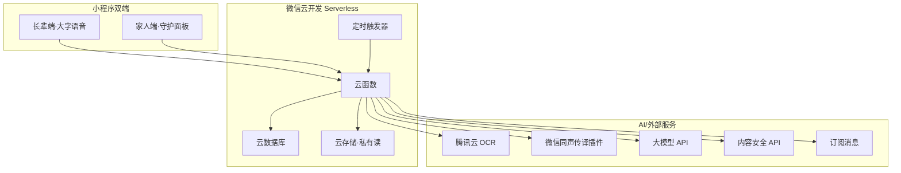
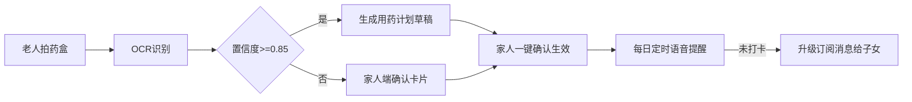

# 暖芯 · 家庭数字陪护与健康管家 小程序设计文档

> 版本：v1.0 ｜ 日期：2026-10-12 ｜ 状态：**已终止（见下方说明）**

> 原因：小程序平台限制（通话能力需资质、后台常驻受限、AI 电话无法落地），且目标用户（老人）日常以 App 为主、不走微信小程序入口。
> 后续方向：转做老人友好的原生 App 或硬件+App 组合。本文档保留作为决策记录与可复用设计资产（领域模型/AI 管线/家庭授权模型可平移到 App 方案）。

---

> 赛事：2026 微信小程序开发大赛（主题"与 AI 共生"）
> 提交截止：**2026-10-17**（距本稿撰写仅剩 5 天，须在此前正式上线并通过审核）

---

## 一、大赛信息与参赛策略

从大赛官网抓取并核验的关键规则：

| 条目 | 内容 |
|------|------|
| 主题 | "与 AI 共生"，鼓励接入微信 AI 生态 |
| 队伍 | 单人或自由组队，**上限 3 人**，每人只能报一份作品 |
| 作品 | 命题不限，须基于微信小程序技术体系，鼓励 AI 能力 |
| 上线要求 | 须在 **2026-07-17 ~ 2026-10-17 提报期间正式上线**并能正常运行（7-17 前已上线的算旧作品） |
| 提交材料 | 身份证件、作品名称、AppID、小程序二维码、**PDF 说明文档**（功能简介/应用场景/解决的实际问题/技术方案/创新点）、参赛授权书 |
| 奖金 | 总池 49 万：一等奖 1 名 10 万、二等奖 3 名各 5 万、三等奖 6 名各 3 万、优秀 AI 创新作品 3 名各 2 万 |

**参赛策略建议**：

1. 本选题天然契合"与 AI 共生"：AI 识药盒/识血压仪、AI 语音陪聊、AI 健康摘要，"接入微信 AI 生态"是加分项。
2. 剩余 5 天的重点排序：**先过审上线**（健康相关类目审核偏慢，今天就注册提审），再补 AI 深度功能。确保截止日有"能在微信内正常运行"的版本。
3. 官方要求的说明文档五要素（功能简介/场景/实际问题/技术方案/创新点）可直接复用本文档第十三节。

---

## 二、产品概述与命名

### 2.1 一句话定位

**"爸妈的健康，装进你的微信里。"**
面向独居/空巢老人的数字陪护与健康管家：老人动口动手就能用，子女在微信里远程守护。

### 2.2 产品命名

| 候选 | 释义 | 备注 |
|------|------|------|
| **牵挂（推荐）** | 两个字口述即懂，子女视角情感最浓 | 面向不识字老人，名字靠"听"传播 |
| 安心伴 | 安心＋陪伴 | 直白，易过审 |
| 暖巢 | 空巢之"巢"的温度反转 | 情感强但略悲情 |
| 陪爸妈 | 动词式，场景直给 | 口语化 |

### 2.3 与既有产品的差异

- 微信"小微"生态（智能音箱/语音助手）重在语音对话入口，本产品把语音对话**落到健康结构化数据与家庭协同**上。
- 智能手环类产品重数据采集，本产品**重轻量无穿戴**：AI 识别设备照片即可录入，老人零学习成本。

---

## 三、用户与场景

### 3.1 双角色设计

| 角色 | 特征 | 交互原则 |
|------|------|---------|
| 长辈端（老人） | 60+，视力/听力/记忆力下降，抗拒复杂 App | 大字版、语音优先、每屏一个任务、点击区 ≥ 88px |
| 家人端（子女） | 25~45 岁，异地，时间碎片化 | 信息流 + 预警推送 + 远程设置（替父母建提醒） |

家庭组织：一个"家庭空间"最多 10 名成员，角色分为长辈 / 家人 / 家庭管理员；子女绑定父母需长辈端确认（防诈骗设计）。

### 3.2 核心场景

1. **吃药**：AI 提醒 → 老人拍药盒 → AI 识别药名/用量自动建档 → 每日语音提醒 → 未确认则升级通知子女。
2. **测血压/血糖**：拍仪器读数照片 → OCR 识别数值 → 自动记录 → 异常值（如收缩压 ≥ 160）触发预警。
3. **日常聊天**：长辈端语音说话 → AI 陪聊 + 天气/饮食/新闻播报 → 情绪偏负向时通知子女。
4. **生活事务**：代挂号、代买药（微信支付由子女端完成，长辈端只展示结果）。

---


### 3.3 零文字交互设计（核心：老人不识字也能用）

目标：长辈端全程不需要读一个字。原则：语音优先、图标即功能、确认也用语音。

| 机制 | 设计 |
|------|------|
| 语音引导 | 打开小程序自动 TTS 播报引导（微信同声传译插件）；每页进入播报一句"现在可以做什么" |
| 图标即功能 | 四大功能用生活物件图标：药盒、血压仪、耳机（聊天）、电话（呼叫家人），不用抽象符号 |
| 时间不用字 | 早/中/晚用图标：太阳 / 太阳偏西 / 月亮；用药打卡就是"点太阳图标+按住说'吃了'" |
| AI 代填+语音确认 | 拍药盒后 AI 播报"这是降压药，每天早上吃一片，对吗？"老人答"对"即确认，无需读字 |
| 一键语音留言 | 不识字也能发语音消息，子女端自动转文字显示 |
| 家人端兜底 | 所有计划/提醒由子女远程设置，长辈端只做"响应"：听提醒→按住说"吃了"→完成 |
| 家人帮助模式 | 保留子女端远程协助入口，兼顾无障碍审核 |

名字传播适配：老人不识字，产品名靠"听"与"说"传播——选定**牵挂**（口述即懂），订阅消息播报文案示例："爸妈今天报了平安，血压正常，药都吃了。"

### 3.4 数据录入与设备支持（录入不重要，录入后怎么管才重要）

**核心定位调整**：产品是"家庭健康记录与提醒"工具，不是"设备连接器"。数据怎么进来不重要——拍照、说话、点按钮、蓝牙，进来之后帮人管、帮人提醒、帮人分析才是价值。这样即使一台蓝牙设备都不接，产品依然完整。

**微信 BLE 生态现实**（影响优先级）：

- 主流品牌（罗氏、部分鱼跃、三诺等）已支持小程序 + 蓝牙直连传数据，无需装 App
- 微信小程序 BLE 能力（openBluetoothAdapter 系列）官方支持成熟
- 部分老旧/低端设备只支持自家 App 或完全无蓝牙——"所有设备直连"做不到，也没必要

**数据录入方式（按优先级）：**

| 优先级 | 方式 | 场景 | 设计要点 |
|--------|------|------|---------|
| ① 拍照识别（主推） | 拍血糖仪/血压计屏幕，AI 识数 | 老人日常，兼容几乎所有设备 | 识别后 TTS 播报+语音确认，置信度低转家人确认 |
| ② 语音录入 | 说"空腹血糖 6.8" | 老人不想找仪器拍 | AI 解析数值+自动分类（空腹/餐后/睡前），歧义时追问一句 |
| ③ 手动大按钮 | 大字大热区点击 | 子女代录、数字简单修正 | 适老化键盘，单位默认勿问 |
| ④ 蓝牙直连（增强项） | 小程序 BLE 对接 2-3 个主流品牌 | 家里有罗氏/鱼跃/三诺蓝牙款 | 加分项不是必须；未适配型号静默降级到① |

**蓝牙直连设计要点（仅作为增强）：**

```
wx.openBluetoothAdapter → discovery → 型号匹配(deviceProfile 映射表)
  → createBLEConnection → 订阅测量特征值 → 解析血压/血糖数据帧
  → 写入 healthRecords(source: 'ble')
覆盖范围: 只承诺 2-3 个主流品牌型号，官网列出支持清单，不宣传"全设备直连"
隐私: 仅用户主动点击"连接设备"时开启，用完即关，不后台扫描
```

**AI 真正发挥作用的地方（"与 AI 共生"亮点，录入之后的闭环）：**

| 能力 | 说明 |
|------|------|
| 趋势图与异常预警 | 自动生成 7/30 天走势，超个人阈值触发分级预警 |
| 饮食/运动联动建议 | 语音记一句"中午吃了碗面"，AI 关联餐后血糖给轻量提示（限定生活建议，不做医疗结论） |
| 定时提醒 | 吃药、测血糖按时段提醒（太阳/月亮图标+语音） |
| 子女远程查看 | 授权后子女端看时间线，异常订阅消息通知 |
| **一键就医报告** | 生成近期血糖/血压汇总页（趋势+极值+规律总结），就医时给医生看——这是家庭最强刚需 |

**数据模型衔接**：healthRecords.source = manual / voice / ocr / ble 四类；devices 集合仅存已绑定的增强设备；所有来源数据同过 alertJob 预警扫描。

**MVP 节奏（5 天窗口）**：①②③ 必保（不依赖任何硬件，演示稳定），④ 现场演示一款欧姆龙蓝牙血压计加分即可。

### 3.5 重点打磨：AI 分析、提醒、家庭共享

**AI 分析（只做信息整理，不做医疗结论）：**

| 能力 | 输入 | 输出 | 边界 |
|------|------|------|------|
| 健康周报/月报 | 已确认记录 | 趋势、极值、规律总结（如"近两周空腹血糖整体偏高 0.8"）、缺失天数 | 不下诊断，附"请咨询医生" |
| 一键就医报告 | 勾选时间范围 | 一页汇总：趋势图+极值+用药依从率+记录原图，供医生查看 | 打印/图片导出 |
| 生活方式联动 | 语音记饮食/运动（"中午吃了碗面"） | 与餐后血糖关联的轻量提示（"今天面食后血糖略高，明天可少半碗"） | 限定生活建议话术库 |
| 通话后摘要（见 3.6） | 通话转写文本 | 状态摘要推子女：情绪、主诉、异常关键词 | 异常关键词只提示"建议回电确认" |

**提醒（三层触达，不依赖单一渠道）：**

```
第1层 小程序内: 打开即见今日待办，TTS 播报（太阳/月亮图标时段）
第2层 订阅消息: 服药/测量提醒 + 未确认升级通知子女（需用户订阅额度）
第3层 守护通话: 重要提醒未被确认时，子女端可发起 AI 语音问候/自己打视频（见 3.6）
防打扰: 静默期 22:00-07:00；同一事项升级通知每日最多 2 次；漏服≠事故，话术用"还没确认"不用"出事了"
```

**家庭共享（授权为核心的协作）：**

- 角色权限细化：长辈（数据主体）/ 家人（查看+远程设置）/ 管理员（成员管理）；每类可见范围在 consents 中按 scope 控制
- 协作闭环：子女远程建提醒/计划 → 长辈端语音确认生效；长辈语音留言 → 子女端转文字+原文可听
- 多子女共同照护：同一长辈可被多位家人关注，预警按成员逐一发送，谁点"已处理"全家庭可见（避免重复慌乱）
- 家庭动态：周报自动生成"家庭共享版"，群里直接转发的小卡片（分享是小程序自然增长入口）

### 3.6 AI 音视频与守护通话（含自动接听设计）

**技术现实（必读）**：小程序不能像系统电话那样在后台被"叫醒"——切后台约 5 秒即挂起，微信也没有让小程序自动拉起前台的能力。所以"自动接听"必须设计成**守护模式下的应用内自动应答**，而不是系统级来电接听。真正的运营商 AI 电话外呼需要呼叫中心资质与语音线路，合规成本高，列为 P2 服务商合作项。

**分层方案：**

| 层级 | 方案 | 说明 | 优先级 |
|------|------|------|--------|
| T1 系统电话兜底 | wx.makePhoneCall 一键拨号 | 子女端"打电话给爸/妈"按钮，走运营商，永远可靠 | P0 |
| T2 守护视频通话 | 小程序内音视频（TRTC/实时音视频）+ 守护模式自动接听 | 见下方流程与 3.8 接入路线；演示现场可跑通 | P1 |
| T3 AI 语音问候 | 子女不在时由 AI 语音代理接聊 | 通话无人接→AI 分身按家庭记忆问候几句→摘要给子女 | P2 |
| T4 运营商 AI 外呼 | 真实手机号 AI 语音电话 | 需呼叫中心资质/线路合作，参赛不出、商业阶段评估 | P2/赛后 |

**守护模式与自动接听流程：**

```
长辈端开启"守护模式"（建议场景: 手机插电放床头柜）:
  wx.setKeepScreenOn 屏幕常亮 + 页面保持前台 + 降噪麦克风常备

子女发起通话:
  子女端点击"给爸妈打视频" → 信令(云数据库/实时数据推送) → 长辈端

长辈端接听策略:
  守护模式开启 + 来电人在白名单(家庭已授权成员) → 3秒倒计时自动接听
  非守护模式 → 全屏大图标来电页(接听/拒绝图标，无文字) + TTS 播报"儿子来电话啦"

通话中 AI 增强:
  实时语音转写字幕(老人听不清可看大字幕)
  异常关键词检测(胸痛/摔了/头晕) → 通话中即提醒子女端
  结束后生成通话摘要(聊了什么/情绪/待办)存家庭时间线，授权成员可见

安全与隐私:
  - 白名单自动接听，陌生微信用户永远需要手动接听
  - 自动接听开启时长辈端有常亮提示条"家人可以随时打来视频"
  - 通话不录制音视频，仅转写文本用于摘要(可关闭)，符合最小化原则
  - 长辈随时语音说"挂了"即挂断并通知子女
```

**资质与合规**：小程序内实时音视频需对应类目资质（如社交/生活服务类目下的音视频能力申报，或接入腾讯云 TRTC 小程序 SDK 方案）；提审时描述为"家人间音视频通话"，避开"远程医疗"表述。T2 演示用同账号双设备即可现场跑通。

### 3.7 接入微信 AI 生态（小微）：评审加分项，但要有降级底线

**背景（2026 年生态现状）**：微信已发布《关于开发者接入微信 AI 生态的指引》，路径为
小程序功能 → 拆原子接口 → 封装 Skill → 经 MCP 协议开放给微信 AI（小微）调用。
首批约 13 家内测；用户可直接对小微说"帮我看看爸爸今天的血压"这类自然语言指令。
这对本产品是**天然契合**：我们的云函数接口本来就是 REST 风格原子化设计。

**接入策略（三步走，先参赛后生态）：**

| 阶段 | 动作 | 说明 |
|------|------|------|
| S1 现在（参赛窗口） | 不依赖小微 | 小微 AI 操作小程序仍在内测/首批阶段，个人主体未必能进；参赛功能全部走自有语音+TTS 链路，**演示不赌生态** |
| S2 申报材料中 | 写入规划 | 在说明文档"技术方案与创新点"中明确：已按《指引》的 Skill 原子接口规范设计云函数，小微开放后可低成本接入，列 3 个首批 Skill（问安打卡/血压查询/用药确认） |
| S3 赛后 | 正式申请接入 | 关注 mp 后台"AI 生态"入口与基础库更新；上线 Skill：健康查询、提醒设置、通话发起，让小微成为长辈端第二语音入口 |

**设计准备（现在就做，成本极低）：**

```
1. 云函数已按原子动作设计(login/health.addRecord/medPlan.markTaken/alert.list ...)
2. 每个 Action 补一份 JSON Schema(入参/出参/语义描述) —— 即 Skill 描述文件雏形
3. 敏感操作(看健康数据/发起通话)设计"长辈确认"环节，与小微的授权模型对齐
4. 接口命名用自然语言友好动词，如 getTodayBloodPressure 而非 hbpV2Query
```

**风险提示**：不得在参赛材料中声称"已接入小微"（内测阶段、未获得资格就是虚假陈述）；
表述统一用"已按微信 AI 生态接入指引完成 Skill 化设计，具备接入条件"。

### 3.8 通话能力接入路线（对齐微信官方音视频生态）

**核实结论（2026 现状）**：微信侧"电话/视频通话"相关能力有三条官方路径，各有门槛，本产品按可达性排序接入：

| 路径 | 能力 | 门槛/资质 | 对本产品意义 |
|------|------|----------|------------|
| ① 小程序实时音视频（live-pusher/live-player + TRTC 插件） | 应用内双向音视频通话，可与微信原生通话体验接近 | 需开通相应类目资质 + 腾讯云 TRTC 服务（有免费额度） | **当前主路径**：守护模式自动接听（3.6 节设计）跑在这条路上 |
| ② 小程序音视频通话能力（微信官方 `wx VOIP` 类标签能力） | 小程序内直接拨打到对方微信接听 | 历史上 `wx.joinVoIPChat` 已下线（官方文档 404）；部分能力以白名单/特定类目开放（如校园、门禁场景） | **跟进项**：关注开放动态，开放即切换，长辈端无需装任何东西，子女在微信里直接接 |
| ③ 腾讯小微硬件生态 | 智能硬件（音箱/带屏设备/门锁如德施曼）经审核接入后获得"微信音视频通话"能力——子女直接在微信里呼叫设备 | 需按腾讯小微硬件审核标准接入（厂商合作） | **硬件演进项**：未来做"问安小屏"硬件时的接入通道 |

**架构设计（为 ②③ 预留，不返工）：**

```
信令层: 独立抽象 callSignaling 模块(发起/振铃/接听/挂断/拒绝 五事件)
  → 载体可替换: 云数据库实时推送(当前) / 微信官方信令(若②开放) / TRTC 信令
媒体层: TRTC SDK 封装为 adapter，接口只暴露 startCall/answer/hangUp
  → 若获②资格，媒体层切到微信原生 VOIP，长辈端 UI/交互逻辑不变
自动接听: 守护模式+白名单策略属于业务层，与媒体层解耦，切换通道时复用
```

**参赛演示口径**：演示走路径①（TRTC，同账号双设备现场可跑通）；材料中表述为
"通话能力按微信官方音视频生态路线设计，待 `wx VOIP` 能力对类目开放后可直接切换，
长辈端体验不变"——既真实又不把宝押在未开放的资质上。

## 四、核心功能设计

### 4.1 功能清单

| 编号 | 模块 | 功能 | 优先级 | 谁用 |
|------|------|------|--------|------|
| F01 | 账号 | 微信登录 + 家庭空间创建/邀请 | P0 | 全部 |
| F02 | 健康 | 血压/血糖/心率/体重记录 | P0 | 长辈+子女 |
| F03 | 健康 | AI 拍照识别录入（药盒/仪器读数） | P0 | 长辈 |
| F03b | 健康 | 语音录入（"空腹血糖6.8"自动解析分类） | P0 | 长辈 |
| F03c | 健康 | 一键生成就医报告（血糖/血压汇总） | P1 | 子女+长辈 |
| F03d | 健康 | 蓝牙直连（限 2-3 款主流品牌，增强项） | P2 | 长辈 |
| F03c | 健康 | 智能药盒开盖记录（设计稿） | P2 | 长辈 |
| F04 | 健康 | 健康档案与趋势图（近 7/30 天） | P0 | 子女 |
| F05 | 用药 | 用药计划 + 语音提醒 + 未服上报 | P0 | 长辈+子女 |
| F06 | 预警 | 异常阈值预警（微信订阅消息） | P0 | 子女 |
| F07 | 陪伴 | AI 语音聊天/每日问候/天气播报 | P1 | 长辈 |
| F08 | 事务 | 代办事项（挂号、买药、缴费） | P1 | 子女发布，长辈确认 |
| F09 | 提醒 | 亲情日程（子女远程建提醒） | P1 | 子女 |
| F10 | 安全 | 紧急联系人一键呼叫（wx.makePhoneCall） | P0 | 长辈 |
| F10b | 通话 | 守护模式视频通话 + 白名单自动接听 | P1 | 长辈+子女 |
| F10c | 通话 | 通话字幕 + 通话后 AI 摘要 | P1 | 子女 |
| F10d | 通话 | AI 语音问候分身（无人接时） | P2 | 长辈 |
| F11 | 隐私 | 数据授权与撤销（家庭成员级） | P0 | 长辈 |

### 4.2 异常预警规则（初版）

| 指标 | 即时预警 | 关注级提示 |
|------|---------|-----------|
| 收缩压 | ≥ 180 或 ≤ 90 | ≥ 160 / ≤ 100（连续 3 次） |
| 舒张压 | ≥ 110 或 ≤ 50 | ≥ 100 |
| 空腹血糖 | ≥ 13.9 或 ≤ 3.9 mmol/L | ≥ 10 连续 2 天 |
| 心率 | ≥ 120 或 ≤ 50 | — |
| 行为 | 当日无任何操作（默认 18:00 检查） | 通知子女"今日尚无记录" |

说明：规则可在家人端按医生建议自定义；"无操作提醒"是独居场景最实用的"暗哨"功能。

---

## 五、AI 能力设计

### 5.1 与微信 AI 生态的结合（对应大赛"接入微信 AI 生态"）

| 能力 | 用法 |
|------|------|
| 微信"小微"语音 | 长辈端语音对话入口（呼应小微硬件场景；小程序内用同套语义意图） |
| 微信同声传译插件 WeChatSI | 语音 → 文本、文本 → 语音（TTS 播报提醒，老人免读字） |
| 腾讯云 OCR | 药盒/血压仪照片文字识别 |
| 腾讯云 OCR 通用印刷体 | 血压仪读数结构化（数值区裁剪后识别） |
| 微信内容安全 API | AI 生成回复与用户上传内容的合规审核 |
| 订阅消息 | 预警触达子女 |

### 5.2 AI 识别管线

```
拍照/拍视频 → 云存储(私有) → OCR → 结构化字段
  药盒: 品名、规格、用法用量 → 建议生成用药计划(家人确认后生效)
  血压仪: 收缩压/舒张压/心率 + 测量时间(如能识别)
  血糖仪: 数值 + 餐前/餐后标记(默认询问)
→ 置信度 < 0.85 时转人工确认卡片：家人端一键确认或修正
```

### 5.3 AI 陪伴对话设计

```
意图层：闲聊陪聊 / 天气 / 健康问答(限科普) / 提醒查询 / 紧急升级
安全层：
- 涉及诊断用药的问题 → 固定话术"这个问题请咨询医生"，并提供"通知家人"按钮
- 检测到求助/跌倒/胸痛等关键词 → 立即推送紧急联系人 + 子女订阅消息
情感层：语音情绪粗分类(低落/焦虑/平静)，连续 3 次低落 → 摘要推给子女
记忆层：家庭空间级记忆(生日、忌口、爱好)，用于个性化问候
```

模型选型：接国产大模型 API（混元/GLM/DeepSeek 任一，云函数调用，密钥放服务端），意图分类与安全拦截用小模型/规则先行，成本可控。

---

## 六、总体架构与技术方案



沿用"评个价"项目已验证的结论：**不买传统服务器**，MVP 全部用微信云开发；云函数按 HTTP 风格封装，预留迁 CVM 路径。

云函数清单：

| 云函数 | 职责 |
|--------|------|
| user | 登录、家庭空间、成员管理 |
| health | 健康记录 CRUD、趋势聚合 |
| aiVision | OCR 识别管线（药盒/仪器） |
| aiChat | 陪伴对话（意图分类 + 大模型 + 安全层） |
| medPlan | 用药计划与提醒任务生成 |
| alertJob | 定时触发（每 5~10 分钟）：扫描阈值、未服药、无操作，产出预警 |
| pushJob | 发送订阅消息（幂等、静默期 22:00~07:00 顺延） |
| care | 代办事项、亲情日程 |

---

## 七、数据模型（云数据库集合）

| 集合 | 关键字段 | 说明 |
|------|---------|------|
| families | name, members[], adminOpenid, inviteCode | 家庭空间 |
| users | openid, role, nickname, avatar, elderProfile | 角色绑定 |
| healthRecords | familyId, userId, type(bp/bs/hr/weight), values, measureTime, source(manual/ocr), imgFileId | 原始记录，不可改只可补 |
| medPlans | familyId, userId, drugName, dosage, freq, times[], startDate, endDate, status | 家人确认后生效 |
| medLogs | planId, date, slot, taken, confirmedAt | 服药打卡 |
| aiMessages | familyId, userId, sessionId, role, content, emotion, safetyFlags | 对话留痕 |
| alerts | familyId, userId, level, type, payload, status, sentAt | 预警流水 |
| cares | familyId, title, detail, assignee, dueAt, status | 代办/日程 |
| consents | familyId, ownerUserId, granteeUserId, scopes[], revokedAt | 家庭数据授权 |

索引：healthRecords(familyId, userId, type, measureTime)、medPlans(userId, status)、alerts(familyId, status)。

---

## 八、关键流程

### 8.1 拍药盒建档



### 8.2 血压异常预警

```
长辈拍血压仪 → OCR 得 165/95 → 入库 → alertJob 检出"关注级"
→ 当日第 2 次超阈 → 升级即时预警 → pushJob 发订阅消息给子女
→ 子女点卡片直达家人端详情 → 视频回拨长辈
```

### 8.3 每日问候（无操作暗哨）

```
每日 08:00 TTS 语音问候 + 播报今日天气/用药安排
18:00 检查长辈端当日是否有过任一交互
  └─ 无 → 向子女推送"今天爸妈还没用过小程序"提醒
```

---

## 九、接口设计（云函数动作）

统一：wx.cloud.callFunction；返回 code/msg/data；长辈端与家人端复用同一套接口，按角色鉴权。

| 编号 | 云函数 | 动作 | 说明 |
|------|--------|------|------|
| API-01 | user | login / createFamily / joinFamily | 登录与家庭绑定 |
| API-02 | health | addRecord / listRecords / trend | 健康记录与趋势 |
| API-03 | aiVision | recognize | 上传图片 fileId，返回结构化结果 |
| API-04 | aiChat | send / history | 对话 |
| API-05 | medPlan | create / confirm / todayList / markTaken | 用药计划 |
| API-06 | care | add / list / done | 代办事项 |
| API-07 | alert | list / ack | 预警列表与确认 |
| API-08 | consent | grant / revoke | 家庭数据授权管理 |

---

## 十、页面设计

| 页面 | 路由 | 要点 |
|------|------|------|
| 长辈首页 | pages/elder/home | 极简四宫格：吃药 / 测血压 / 聊天 / 呼叫家人；字号 ≥ 22px |
| 拍照录入 | pages/elder/capture | 相机取景框 + 语音引导"把药盒对准框内" |
| 用药打卡 | pages/elder/meds | 今日三栏：早/中/晚，大按钮"吃了" |
| AI 陪伴 | pages/elder/chat | 全语音交互，按住说话，TTS 回复 |
| 家人面板 | pages/family/dashboard | 父母健康卡片 + 今日服药状态 + 预警流 |
| 趋势详情 | pages/family/trend | 血压折线（ec-canvas 或 Skyline 自绘） |
| 远程设置 | pages/family/settings | 替父母建提醒、设阈值、管理授权 |
| 邀请绑定 | pages/family/bind | 扫码/邀请码 + 长辈端确认弹窗（防诈骗） |

---

## 十一、合规、安全与医疗边界

| 事项 | 措施 |
|------|------|
| **不做医疗诊断** | 全产品定位"健康记录与提醒工具"；AI 回答限定健康科普；页面明示"不能替代医疗建议" |
| 类目与资质 | 不涉及诊疗/器械销售则避开医疗类目资质；提审类目建议"生活服务/工具"；挂号跳转官方渠道（如腾讯健康）完成 |
| 个人信息保护 | 健康数据属敏感个人信息：单独同意 + 家庭成员级授权(consents) + 可随时撤销 + 删除即物理删除 |
| 图片隐私 | 云存储私有读，临时 URL 30 分钟；OCR 用后即删原图（可配置保留） |
| 防诈骗 | 绑定需长辈端确认；订阅消息明示来源；AI 不代任何金融/验证码操作 |
| 内容安全 | 对话与 OCR 文本过 msgSecCheck；图片过 imgSecCheck |
| 长辈模式 | 字号、对比度、点击热区符合适老化规范，也是评审加分点 |

---

## 十二、里程碑与分工（截止 10-17，仅 5 天）

| 天 | 目标 |
|----|------|
| D1 | 注册小程序、确认提审类目、云开发环境初始化、双端骨架 + 登录 + 家庭绑定 |
| D2 | 健康记录 CRUD + 手动录入 + 趋势图；订阅消息申请与打通 |
| D3 | OCR 识别管线（血压仪优先）+ 用药计划与打卡 + alertJob/pushJob |
| D4 | AI 陪伴对话（意图 + 大模型 + 安全层）+ 家人面板完善 |
| D5 | 适老化打磨、真机测试、提审上线、提交材料（AppID、二维码、PDF 说明文档、授权书） |

3 人分工建议：A 小程序双端；B 云函数 + 数据 + 定时任务；C AI 管线（OCR/对话/安全）+ 参赛材料。

> 若时间不足：P0 保命线 = 健康记录 + OCR 血压识别 + 用药提醒 + 阈值订阅消息预警。AI 陪聊可降级为"问候播报"。

---

## 十三、创新点总结（评审视角）

1. **AI 使能"零学习成本"**：老人不会打字不会操作？拍张药盒/血压仪照片，AI 全部搞定——AI 不是炫技，是适老化的核心手段。
2. **接入微信 AI 生态**：同声传译插件（语音交互）、内容安全、订阅消息、（可扩展）小微语音入口，完整回应大赛主题"与 AI 共生"。
3. **"无操作暗哨"**：不穿戴、不监控、不侵犯隐私，用"今天有没有动静"守护独居安全——轻量且直击空巢痛点。
4. **家庭数据授权模型**：健康数据敏感，成员级授权 + 撤销机制，合规即卖点。
5. **Serverless 全家桶**：免运维、成本低，5 天可上线，可复制到更多家庭。

---

## 十四、风险与应对

| 风险 | 等级 | 应对 |
|------|------|------|
| 小程序审核来不及（健康类敏感） | 高 | 今天提审；类目避开"医疗"，走"生活服务/工具"；描述措辞用"记录/提醒"，不用"诊断/监测治疗" |
| OCR 对老式血压仪识别率低 | 中 | 支持家人手动修正卡片；置信度阈值可调；样张引导拍数值区 |
| 订阅消息一次订阅一发 | 中 | 家人端常驻引导"总是保持"；预警分级，仅即时级强打扰 |
| 大模型成本与延迟 | 中 | 意图分类小模型先行，仅闲聊走大模型；缓存天气等高频回答 |
| 医疗合规边界被误用 | 中 | 全链路免责声明 + 紧急情况引导呼叫 120/紧急联系人 |

---

## 附录

- 大赛官网（本设计核验来源）：https://contest.weixin.qq.com/eventDetails?id=4598379302114656257
- 微信同声传译插件：https://developers.weixin.qq.com/miniprogram/plugins/
- 云开发文档：https://developers.weixin.qq.com/miniprogram/dev/wxcloud/basis/getting-started.html
- 订阅消息：https://developers.weixin.qq.com/miniprogram/dev/framework/open-ability/subscribe_message.html
- 内容安全：https://developers.weixin.qq.com/miniprogram/dev/api-backend/open-api/sec-check/security.msgSecCheck.html